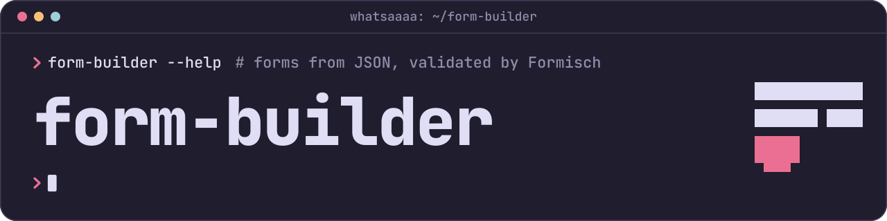

# @whatsaaaa/form-builder-affects

Show, hide and clear the fields, sections and steps of JSON form definitions by conditions.

[](https://www.npmjs.com/package/@whatsaaaa/form-builder-affects)
[](https://www.npmjs.com/package/@whatsaaaa/form-builder-affects)
[](https://github.com/whatsaaaa/form-builder/actions/workflows/ci.yml)
[](https://codecov.io/gh/whatsaaaa/form-builder)
[](https://bundlejs.com/?q=@whatsaaaa/form-builder-affects&treeshake=%5B%7Baffects%7D%5D&config=%7B%22esbuild%22:%7B%22external%22:%5B%22valibot%22,%22@whatsaaaa/form-builder-schema%22%5D%7D%7D)
[](https://www.npmjs.com/package/@whatsaaaa/form-builder-affects)
[](https://github.com/whatsaaaa/form-builder/blob/main/LICENSE)

This package is an extension for [`@whatsaaaa/form-builder-schema`](https://github.com/whatsaaaa/form-builder/tree/main/packages/schema). It adds `affects` to definitions: conditions on the values of other fields that show a field, hide it, or hide it and clear its value. A hidden field isn't validated, in every Formisch package and in a plain `v.parse`.

## Install

```sh
pnpm add @whatsaaaa/form-builder-affects @whatsaaaa/form-builder-schema valibot
```

## Example

Give the schema builder the extension, and write `affects` on the fields:

```ts
import { affects } from '@whatsaaaa/form-builder-affects'
import { createSchemaBuilder, type JsonForm } from '@whatsaaaa/form-builder-schema'

const builder = createSchemaBuilder({ extensions: [affects()] })

const json: JsonForm = {
  version: '1',
  fields: [
    {
      name: 'accountType',
      type: 'radio',
      required: true,
      options: [
        { value: 'personal', label: 'Personal' },
        { value: 'business', label: 'Business' },
      ],
    },
    {
      name: 'vatId',
      type: 'text',
      required: true,
      affects: [{ effect: 'hideAndClear', when: { field: 'accountType', notEquals: 'business' } }],
    },
  ],
}

const schema = builder.build(json) // vatId is required only for a business account
```

With the Vue or React adapter, pass the builder to `useJsonForm`, and hidden fields, sections and steps leave the form. Without the extension, `affects` is an unknown key, so a definition never runs without its conditions by mistake.

## Highlights

- Three effects: `show`, `hide`, and `hideAndClear`, which also blanks the value
- Conditions on any field by its path, combined with `all` and `any`
- Works on fields at any depth, display elements, and the layout's sections and steps
- Hidden fields skip validation, so a required field only counts while it shows
- Checks every condition against the fields it reads, and reports loops
- `getVisibility` tells a renderer in any framework what to hide and clear
- Ships a `definition.schema.json` with `affects` for editor autocompletion

## Documentation

- [Guide](https://whatsaaaa.github.io/form-builder/guide/conditions): effects, conditions and their operators, what a hidden field does, groups, sections and steps, loops and rendering
- [API reference](https://whatsaaaa.github.io/form-builder/api/affects/)

## Related packages

- [`@whatsaaaa/form-builder-schema`](https://github.com/whatsaaaa/form-builder/tree/main/packages/schema): build Formisch-ready Valibot schemas from JSON definitions
- [`@whatsaaaa/form-builder-vue`](https://github.com/whatsaaaa/form-builder/tree/main/frameworks/vue): render definitions with your own Vue components
- [`@whatsaaaa/form-builder-react`](https://github.com/whatsaaaa/form-builder/tree/main/frameworks/react): render definitions with your own React components

## License

[MIT](https://github.com/whatsaaaa/form-builder/blob/main/LICENSE)
