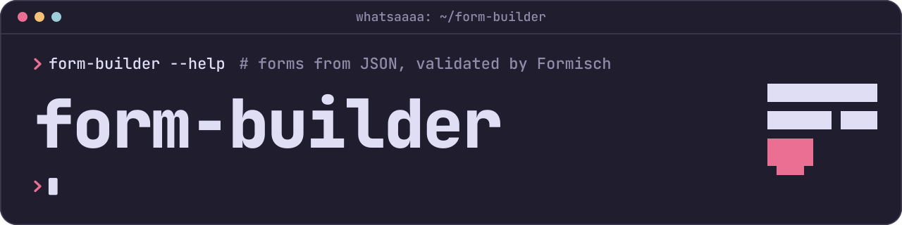

# @whatsaaaa/form-builder-fills

Fill the fields of JSON form definitions from the value of another field, with values from the definition or from your own sources.

[](https://www.npmjs.com/package/@whatsaaaa/form-builder-fills)
[](https://www.npmjs.com/package/@whatsaaaa/form-builder-fills)
[](https://github.com/whatsaaaa/form-builder/actions/workflows/ci.yml)
[](https://codecov.io/gh/whatsaaaa/form-builder)
[](https://bundlejs.com/?q=@whatsaaaa/form-builder-fills&treeshake=%5B%7Bfills%7D%5D&config=%7B%22esbuild%22:%7B%22external%22:%5B%22valibot%22,%22@whatsaaaa/form-builder-schema%22%5D%7D%7D)
[](https://www.npmjs.com/package/@whatsaaaa/form-builder-fills)
[](https://github.com/whatsaaaa/form-builder/blob/main/LICENSE)

This package is an extension for [`@whatsaaaa/form-builder-schema`](https://github.com/whatsaaaa/form-builder/tree/main/packages/schema). It adds `fills` to definitions: each new value of a field, like a profile picked from a select, sets other fields of the form. The values are written in the definition, or come from a source of yours, like a call to your server, so the definition stays plain JSON.

## Install

```sh
pnpm add @whatsaaaa/form-builder-fills @whatsaaaa/form-builder-schema valibot
```

## Example

Give the schema builder the extension, with the sources your definitions name, and write `fills` on the field whose value fills the others:

```ts
import { fills, type FillSource } from '@whatsaaaa/form-builder-fills'
import { createSchemaBuilder, type JsonForm } from '@whatsaaaa/form-builder-schema'

// Any function works: the values can come from a server, a store or a constant.
const profiles: FillSource = async (value, { signal }) => {
  const response = await fetch(`/api/profiles/${encodeURIComponent(value)}`, { signal })
  if (!response.ok) throw new Error(`Profile ${value}: HTTP ${response.status}`)
  return response.json() // like { firstName: 'Marko', lastName: 'Petrović', 'address.city': 'Beograd' }
}

const builder = createSchemaBuilder({ extensions: [fills({ sources: { profiles } })] })

const json: JsonForm = {
  version: '1',
  fields: [
    {
      name: 'profile',
      type: 'select',
      options: [
        { value: 'a', label: 'Profile A' },
        { value: 'b', label: 'Profile B' },
      ],
      fills: { source: 'profiles', fields: ['firstName', 'lastName', 'address.city'] },
    },
    { name: 'firstName', type: 'text' },
    { name: 'lastName', type: 'text' },
    { name: 'address', type: 'group', fields: [{ name: 'city', type: 'text' }] },
  ],
}
```

Or write the values in the definition, for each value of the field:

```json
"fills": {
  "map": {
    "a": { "firstName": "Marko", "lastName": "Petrović", "address.city": "Beograd" },
    "b": { "firstName": "Jelena", "lastName": "Jovanović", "address.city": "Novi Sad" }
  }
}
```

The builder's `getFills()` runs them while a form is open, in any framework. Without the extension, `fills` is an unknown key, so a definition never runs without its fills by mistake.

## Highlights

- Values from a map in the definition, or from your own sources, sync or async
- A new value aborts the call before it through its `AbortSignal`, so the newest one wins
- Leaves the fields the user edited, unless `overwrite` is `"always"`
- Fills a new form from a field's default, and never a saved record the form starts with
- Fits each value to its field, and sets only the fields the fill names
- Checks every path, value and source name, and reports fills that set each other in a loop
- Ships a `definition.schema.json` with `fills` for editor autocompletion

## Documentation

- [Extensions guide](https://whatsaaaa.github.io/form-builder/guide/extensions#fills): when a fill runs, what it sets, and how a renderer runs it
- [API reference](https://whatsaaaa.github.io/form-builder/api/fills/)

## Related packages

- [`@whatsaaaa/form-builder-schema`](https://github.com/whatsaaaa/form-builder/tree/main/packages/schema): build Formisch-ready Valibot schemas from JSON definitions
- [`@whatsaaaa/form-builder-affects`](https://github.com/whatsaaaa/form-builder/tree/main/packages/affects): show, hide and clear fields by conditions

## License

[MIT](https://github.com/whatsaaaa/form-builder/blob/main/LICENSE)
