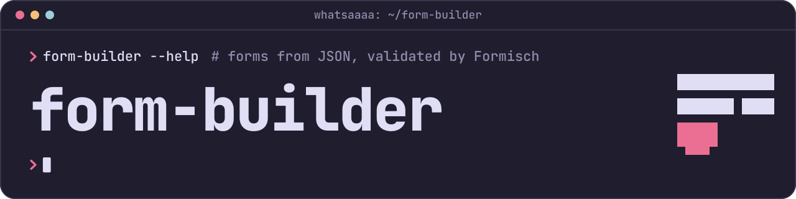

# @whatsaaaa/form-builder-schema

Build Formisch-ready [Valibot](https://valibot.dev) schemas from JSON form definitions.

[](https://www.npmjs.com/package/@whatsaaaa/form-builder-schema)
[](https://www.npmjs.com/package/@whatsaaaa/form-builder-schema)
[](https://github.com/whatsaaaa/form-builder/actions/workflows/ci.yml)
[](https://codecov.io/gh/whatsaaaa/form-builder)
[](https://bundlejs.com/?q=@whatsaaaa/form-builder-schema&treeshake=%5B%7BcreateSchemaBuilder%7D%5D&config=%7B%22esbuild%22:%7B%22external%22:%5B%22valibot%22%5D%7D%7D)
[](https://www.npmjs.com/package/@whatsaaaa/form-builder-schema)
[](https://github.com/whatsaaaa/form-builder/blob/main/LICENSE)

This is the core of [form-builder](https://github.com/whatsaaaa/form-builder). It reads a JSON form definition, checks it, and builds the Valibot schema of the whole form, ready for [Formisch](https://formisch.dev) or a plain `v.parse`. It also gives renderers in any framework what they need: the initial input, the resolved layout and the field tree.

## Install

```sh
pnpm add @whatsaaaa/form-builder-schema valibot
```

Valibot 1.3 or later is required. To render forms, also add Formisch's package for your framework, which needs Valibot 1.4.1 or later.

## Example

```ts
import { createSchemaBuilder, type JsonForm } from '@whatsaaaa/form-builder-schema'

const json: JsonForm = {
  version: '1',
  fields: [
    { name: 'email', type: 'email', label: 'Email', required: { message: 'Email is required' } },
    {
      name: 'password',
      type: 'password',
      required: true,
      rules: [{ rule: 'minLength', value: 10, message: 'At least 10 characters' }],
    },
  ],
}

const { build, validate } = createSchemaBuilder()
const schema = build(json) // a Valibot schema of the whole form, ready for Formisch or v.parse
```

`validate(json)` never throws: it returns every problem in the definition, so you can check definitions that come from outside your code before you build them.

With Formisch, one builder gives the form its schema and initial input, and you the layout to render:

```ts
const builder = createSchemaBuilder()

const form = useForm({ schema: builder.build(json), initialInput: builder.getInitialInput(json) })
const { steps } = builder.getLayout(json)
```

## Highlights

- A field type for every native control, plus groups, arrays and display elements
- Every Valibot action that fits in JSON as a rule, and form rules that compare fields
- Layout in the definition: sections, a 12-column grid, slots and steps
- Checks that report every problem with its path, instead of failing on the first one
- `defineForm` for typed definitions in TypeScript, and a JSON Schema for editor autocompletion
- Your own field types, rules, messages and extensions, like conditions from the affects package
- Works with Formisch's own package for every framework, with no adapter needed

## Documentation

- [Guide](https://whatsaaaa.github.io/form-builder/guide/): field types, rules, form rules, layout, checks, extending and messages
- [Rendering with Formisch](https://whatsaaaa.github.io/form-builder/frameworks/formisch): a tested renderer for Preact, Solid, Svelte, Qwik and Angular
- [API reference](https://whatsaaaa.github.io/form-builder/api/schema/), with every built-in [rule](https://whatsaaaa.github.io/form-builder/api/schema/rules) and [field type](https://whatsaaaa.github.io/form-builder/api/schema/field-types)

## Related packages

- [`@whatsaaaa/form-builder-affects`](https://github.com/whatsaaaa/form-builder/tree/main/packages/affects): show, hide and clear fields by conditions
- [`@whatsaaaa/form-builder-vue`](https://github.com/whatsaaaa/form-builder/tree/main/frameworks/vue): render definitions with your own Vue components
- [`@whatsaaaa/form-builder-react`](https://github.com/whatsaaaa/form-builder/tree/main/frameworks/react): render definitions with your own React components

## License

[MIT](https://github.com/whatsaaaa/form-builder/blob/main/LICENSE)
